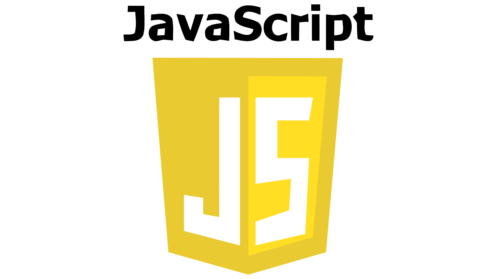
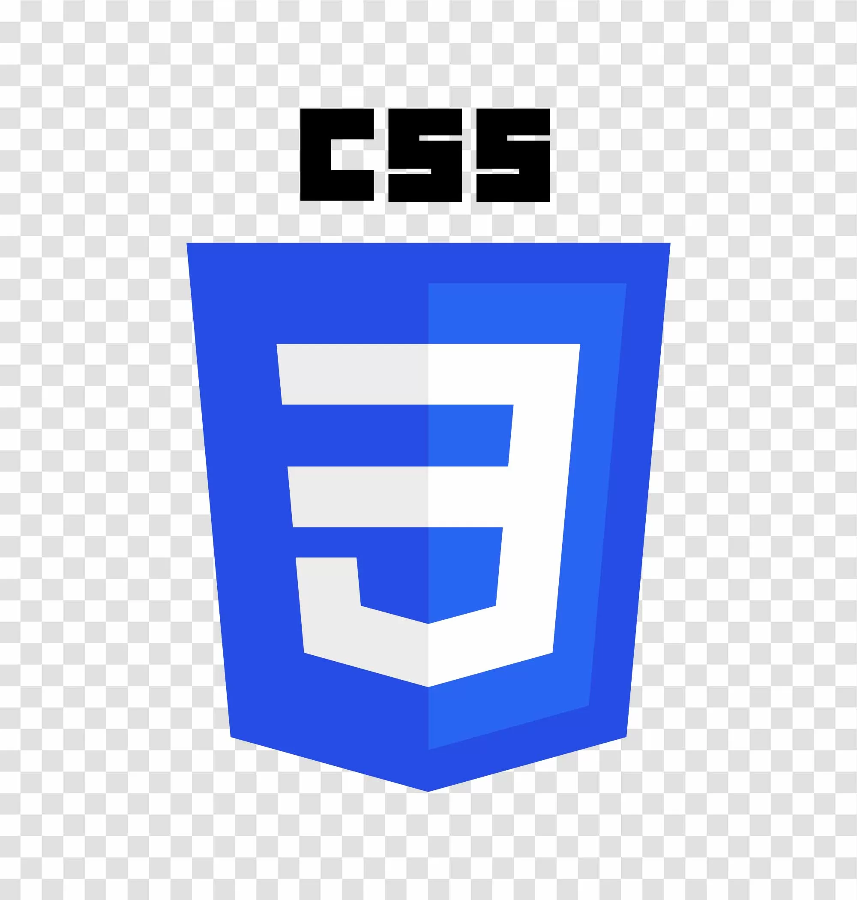

# Olá! Eu sou Matheus Moura 👋

🚀 **[ACESSE MEU PORTFÓLIO](https://matheusmoura198.github.io/matheusmoura198/)** — projetos, apresentação e objetivos profissionais.

🎓 **Estudante de Técnico em Informática**

## Sobre mim

Sou estudante de Técnico em Informática na **Escola Estadual de Ensino Profissional Deputado Roberto Mesquita** e resido no município de **General Sampaio – CE, Brasil**.

Tenho interesse em tecnologia e desenvolvimento de software. Estou construindo minha base na programação, praticando e desenvolvendo projetos para ampliar meus conhecimentos.

## Tecnologias e conhecimentos

Atualmente, estudo e pratico:

| JavaScript | HTML | CSS | APIs e Banco de Dados |
|:---:|:---:|:---:|:---:|
| | | | |
| Em aprendizado | Em aprendizado | Em aprendizado | Estudando e aprendendo |

## Objetivos

Meu objetivo é concluir o Ensino Médio e o curso Técnico em Informática, ingressar em uma faculdade de **Engenharia de Software** e continuar minha trajetória profissional na área de Tecnologia da Informação (TI).

Quero seguir aprendendo, desenvolver projetos cada vez melhores e transformar conhecimento em soluções úteis.

---

📍 General Sampaio – Ceará, Brasil  
📚 Técnico em Informática  
🎮 Interessado em Pokémon, games e desenvolvimento  
🚀 Em constante aprendizado
